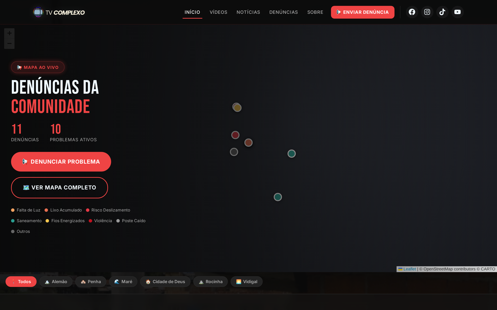
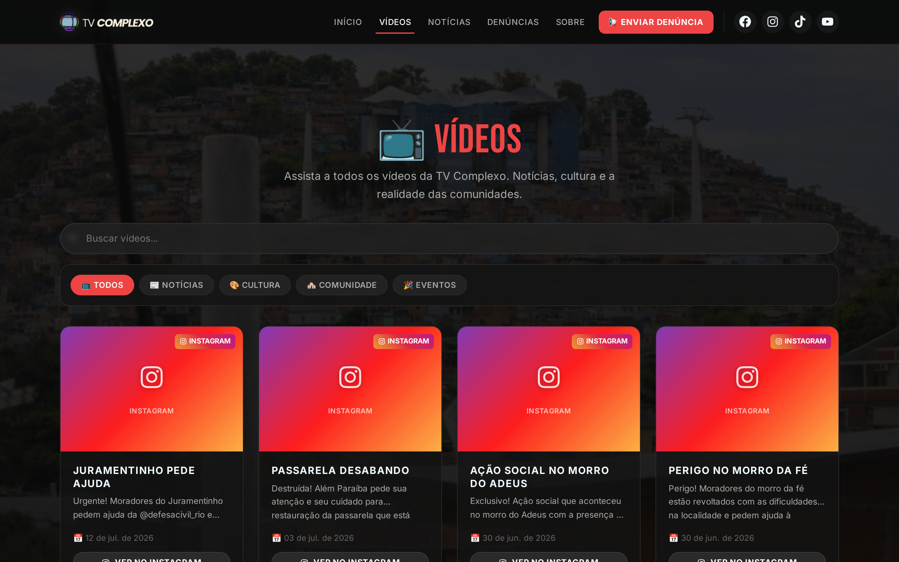
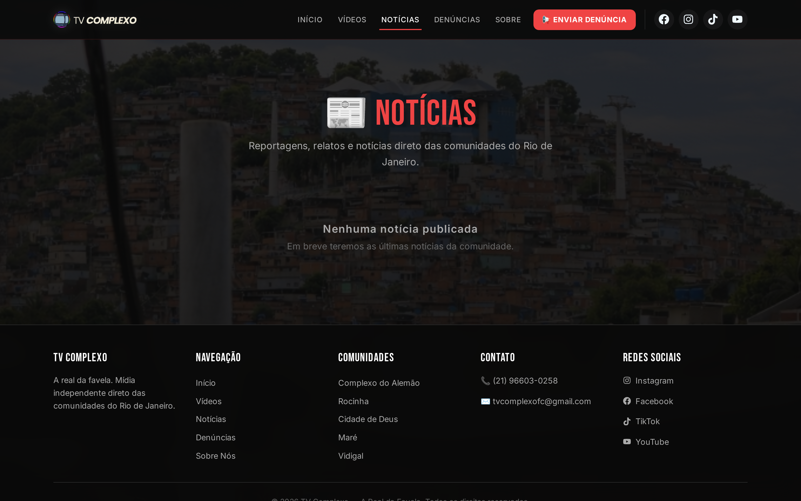
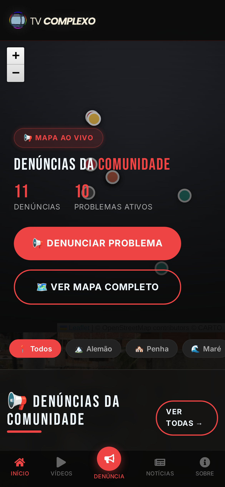

# TV Complexo

**A Real da Favela — Plataforma de Mídia Comunitária**

A voz que ecoa da favela. Vídeos, denúncias e notícias direto das comunidades do Rio de Janeiro.

🔗 **Demo ao vivo:** https://tv-complexo.vercel.app

[](https://tv-complexo.vercel.app)
[](https://nextjs.org)
[](https://neon.tech)



## O problema

Moradores das comunidades têm pouco espaço para mostrar o que acontece no território e cobrar soluções para problemas do dia a dia (falta de luz, lixo, saneamento, risco de deslizamento). O TV Complexo junta, num só lugar, os vídeos do canal, notícias locais e um mapa de denúncias geolocalizadas, com um painel para a equipe moderar o conteúdo.

## Telas

| Vídeos | Notícias | Mobile |
|---|---|---|
|  |  |  |

---

## Funcionalidades

- **Vídeos** — Feed estilo TikTok com importação automática do YouTube (Vercel Cron diário)
- **Denúncias** — Envio com geolocalização + mapa interativo (Leaflet) com marcadores por tipo
- **Notícias** — Artigos com sistema de comentários
- **Admin** — Dashboard protegido com JWT para moderação de conteúdo
- **SEO** — Sitemap dinâmico, Open Graph, robots.txt, PWA manifest
- **Segurança** — Middleware de autenticação, rate limiting, security headers, proteção XSS

## Tech Stack

| Camada | Tecnologia |
|--------|-----------|
| Framework | Next.js 16 (App Router) |
| Frontend | React 19, CSS custom properties |
| Banco de Dados | PostgreSQL (Neon) |
| Autenticação | JWT (jose) |
| Mapa | Leaflet + OpenStreetMap (sem chave de API) |
| Deploy | Vercel |
| Automação | Vercel Cron Jobs (YouTube RSS) |

## Rodando Localmente

```bash
# 1. Clonar o repositório
git clone https://github.com/Estevamjd/TV-COMPLEXO.git
cd TV-COMPLEXO

# 2. Instalar dependências
npm install

# 3. Configurar variáveis de ambiente
cp .env.example .env
# Preencher as variáveis no arquivo .env

# 4. Inicializar o banco de dados
node scripts/init-db.js

# 5. Rodar o servidor de desenvolvimento
npm run dev
```

O site estará disponível em `http://localhost:3000`.

## Variáveis de Ambiente

| Variável | Descrição |
|----------|-----------|
| `DATABASE_URL` | Connection string do PostgreSQL (Neon) |
| `JWT_SECRET` | Chave secreta para tokens JWT |
| `ADMIN_USER` | Username do administrador |
| `ADMIN_PASSWORD` | Senha do administrador |
| `ADMIN_EMAIL` | Email do administrador |
| `YOUTUBE_CHANNEL_ID` | ID do canal do YouTube para importação automática |
| `CRON_SECRET` | Secret para proteger o endpoint do cron |
| `WEBHOOK_SECRET` | Secret para webhooks de redes sociais (opcional) |

## Estrutura do Projeto

```
app/
├── page.js                  # Homepage
├── videos/                  # Listagem e detalhe de vídeos
├── noticias/                # Listagem e detalhe de notícias
├── denuncias/               # Mapa + listagem + formulário de envio
├── admin/                   # Dashboard administrativo
├── api/                     # API Routes (CRUD + auth + cron)
├── sitemap.js               # Sitemap dinâmico
├── robots.js                # Robots.txt
└── manifest.js              # PWA manifest

components/                  # Componentes reutilizáveis
lib/                         # Utilitários (db, auth, rate-limit, video-utils)
scripts/                     # Scripts de inicialização e manutenção do banco
```

## Deploy

O projeto está configurado para deploy automático na Vercel. Cada push no branch `master` dispara um novo deploy.

O arquivo `vercel.json` configura um Cron Job que importa vídeos do YouTube automaticamente uma vez por dia (08:00 UTC).

## Autor

Feito por **Estevam Juliano** — [LinkedIn](https://www.linkedin.com/in/estevam-juliano-8799b026b/) · [GitHub](https://github.com/Estevamjd)

## Redes Sociais

- [Instagram](https://www.instagram.com/tvcomplexo)
- [TikTok](https://www.tiktok.com/@tvcomplexo)
- [YouTube](http://www.youtube.com/@tvcomplexofc)
- [Facebook](https://www.facebook.com/share/18JkYR2cBS/)

---

Feito com a comunidade, para a comunidade.
